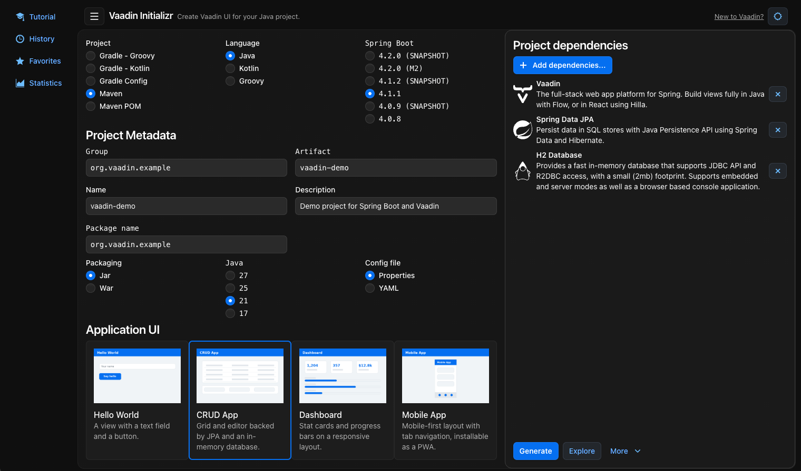

= startvaadin.com 

This repository configures a {library}[Spring Initializr] instance with a custom 
Vaadin UI running at https://pro.startvaadin.com/. The UI is a server-side
https://vaadin.com/[Vaadin] application hosted inside `start-site`.

The following modules are available:

* `start-site`: server infrastructure, metadata configuration, and the Vaadin UI
* `start-site-verification`: tests to verify the validity of the metadata

[[using]]
== Using
There is a link:USING.adoc[dedicated page] that describes how you can interact with the
service.

[[build]]
== Building from Source

You need Java 21 and a bash-like shell.

[[building]]
=== Building

Invoke the build at the root of the project

[indent=0]
----
    $ ./mvnw clean install
----

The project also includes a number of longer-running verification tests. They
can be built and run using the `verification` profile:

[indent=0]
----
    $ ./mvnw -Pverification clean install
----

The project's other tests are not included in the `verification` profile. All of
the project's tests can be run using the `full` profile:

[indent=0]
----
    $ ./mvnw -Pfull clean install
----

For a production build that includes Vaadin's optimized frontend bundle, enable
the `production` profile:

[indent=0]
----
    $ ./mvnw -Pproduction clean install
----

[[run-app]]
=== Running the app locally
You can start the app as any other Spring Boot app. In development mode Vaadin
provisions Node + Vite on first run, so this also doubles as a frontend dev
server:

[indent=0]
----
    $ cd start-site
    $ ../mvnw spring-boot:run
----

[[run-ide]]
=== Running the app in an IDE
You should be able to import the project into your IDE with no problems. Once there you
can run the `StartApplication` from its main method and debug it. If you also need to
work on the library, adding the `initializr` project in your workspace would make sure
to reload the app whenever you make any change.

This is the recommended way to operate while you are developing the application,
especially the UI.

== Reusing the Web UI
This instance has a thin layer with our opinions about getting started with Spring Boot.
You can reuse them but please keep in mind that this is not supported with the same
level as the Spring Initializr library. The Web UI, in particular, is for our own
purpose and is not particularly engineered to be easily extended.

== Jar deployment

The application is deployed as a plain runnable jar (no container image). The
self-contained executable fat jar (`start-site-exec.jar`, with the Vaadin production
bundle baked in) is all that runs; a container would only wrap the same jar around a JRE.

Build and run the production jar locally to verify it is self-contained:

[indent=0]
----
    $ ./mvnw -Pproduction -pl start-site -am -Dmaven.test.skip=true clean package
    $ java -jar start-site/target/start-site-exec.jar
----

`-Pproduction` runs the Vaadin `build-frontend` goal, which bakes the optimized frontend
bundle into the jar. Without it the jar relies on the dev-mode frontend and must not be
deployed.

The jar is built locally and only the binary is shipped to the server, which runs it
with `java -jar`. The runtime needs:

* *Java 21* (Vaadin 25 needs a Java 21 runtime).
* *Durable storage* mounted at the `statistics/` directory next to the jar, so generation
statistics survive restarts.
* The default `application.statistics.file` is `statistics/statistics.json`, relative to the
working directory, so start the jar from the directory that contains `statistics/`.
Override it with `APPLICATION_STATISTICS_FILE` to store the file elsewhere.
* `-XX:MaxRAMPercentage=75` as a JVM argument, for container-aware heap sizing.
* `APPLICATION_PUBLIC_URL`, only if the public URL differs from the default.

The app holds server-side Vaadin session state and keeps per-instance statistics, so it
runs as a *single instance*: set min = max = 1 instance and disable autoscaling. Running
multiple instances would require sticky sessions and a rethink of statistics storage.

=== Pinned versions

As in start.spring.io, every external version is pinned in the repository and changes
through a small "Upgrade to X" commit, so a deploy ships exactly what was tested.
Nothing is fetched from third parties while the site runs. Versions that upstream
maintains (the Vaadin BOM mapping in `application.yml`, for example) arrive by syncing
with upstream. The versions this fork owns are moved before each deploy by the local
deploy tooling:

* Vaadin agent skills: the `vaadin-agent-skills.ref` commit in `start-site/pom.xml`,
fetched from `vaadin/agent-skills` at build time.
* Add-ons with a version in `extra-dependencies.yml`, and Dev Tunnel: the newest release
in the same major version. Major upgrades are reported, not applied.
* The site's own `vaadin.version`: the version of upstream's Vaadin BOM mapping.
* The Spring Boot versions offered in the UI: `boot-versions.yml`, a snapshot from
spring.io, written by `BootVersionsSnapshotTests` when run with `-DbootVersions=write`.

The build fetches the agent skills from `codeload.github.com`, so it needs network
access, as it does for Maven Central. After `clean`, run
`./mvnw -pl start-site generate-resources` once before starting the app from an IDE.

== License
The start.spring.io website is Open Source software released under the
https://www.apache.org/licenses/LICENSE-2.0.html[Apache 2.0 license].
